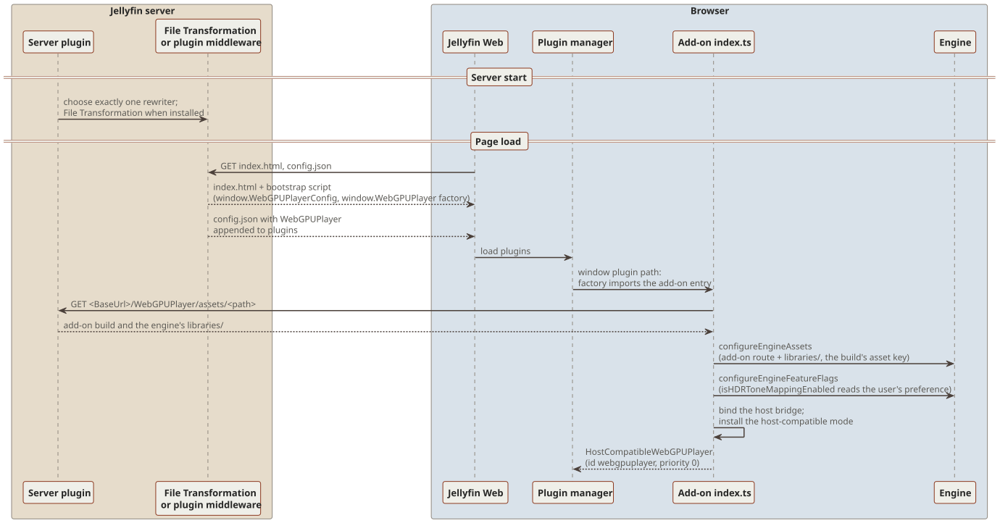
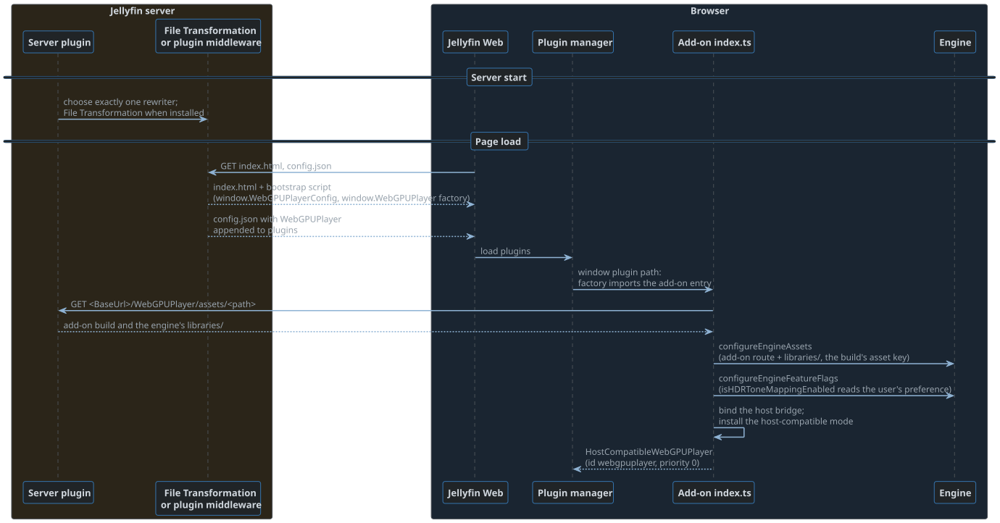

# The client add-on

The add-on is the part of the plugin that runs in Jellyfin Web.
It wraps the engine in a Jellyfin player and supplies the device profile, the settings, and the HTML fallback.

| Path | Holds |
| --- | --- |
| `Jellyfin.Plugin.WebGPUPlayer/` | The server plugin: the web client rewrites, the asset route, and the decoders and passes it offers, with their routes and settings page |
| `jellyfin-webgpu-client/` | The add-on, a private npm package with its sources in `src/` |
| `jellyfin-webgpu-client/vendor/webgpu-player/` | The engine: a submodule, and an npm workspace of the add-on |
| `jellyfin-webgpu-client/vendor/webgpu-player-hls/` | The hls.js fork, a submodule |
| `jellyfin-webgpu-client/vendor/jellyfin-web/` | The Jellyfin Web the add-on builds against: a shallow submodule, read-only |
| `jellyfin-webgpu-client.tests/` | The add-on's Vitest suites, mirroring its `src/` |
| `bin/jellyfin-webgpu-client/` | The add-on build, which the plugin embeds |
| `docs/` | This book |

## How the add-on reaches the page

<div class="diagram">
<a class="diagram-light" href="diagrams/add-on-bootstrap.light.svg"></a>
<a class="diagram-dark" href="diagrams/add-on-bootstrap.dark.svg"></a>
</div>

1. The server plugin rewrites two Jellyfin Web files, through the File Transformation plugin when it is installed and through its own middleware otherwise.
   `index.html` gets a bootstrap script that sets `window.WebGPUPlayerConfig` (the asset base URL and the entry module path) and defines `window.WebGPUPlayer`, a factory that imports the add-on entry.
   `config.json` gets `WebGPUPlayer` appended to its `plugins` list.
2. Jellyfin Web's plugin manager loads `WebGPUPlayer` through its window plugin path and constructs it with its dependency bag.
3. `jellyfin-webgpu-client/src/index.ts` configures the engine: the asset base is the add-on route plus `libraries/`, the cache key is the engine build's asset key, and `isHDRToneMappingEnabled` reads the user's preference.
   It names the build whose capability probe verdicts the engine stores, the engine's asset key joined with webpack's `__webpack_hash__`, which also changes with the add-on's own probe code and profile rules.
   It then binds the host bridge, starts the probe crash reports (`ProbeCrashReports.ts`, below) and the playback fallback reports (`PlaybackFallbackReports.ts`, below), starts the capability probe warm-up (`CapabilityProbeWarmUp.ts`), installs the outdated page reload (`OutdatedPageReload.ts`, below), installs the host-compatible mode, and returns a `HostCompatibleWebGPUPlayer`.
   The warm-up runs only with custom decode on and the runtime available, and only on a client whose [decoder test timing](#decoder-test-timing) is `background`; the engine skips it on a client that asks to save data or has fewer than four threads.
   It tells the engine at once that PlaybackManager's `isPlaying()` holds background probes, so none runs during a playback; see [Negotiation](negotiation.md).
   `index.ts` does not wait for the warm-up, which decides whether it runs once the server's client defaults settle and logs that decision once to the console.
4. The plugin serves the add-on build at `<BaseUrl>/WebGPUPlayer/assets/<path>`, the engine's served folder included.

## Outdated pages

An open tab keeps the add-on build it loaded, its decode workers included, until it reloads.
`OutdatedPageReload.ts` reloads such a tab by itself between plays, so a deploy reaches every open tab without a hard refresh or cleared site data.

- A build's identity is its entry module path, such as `plugin.<contenthash>.js`, which webpack names by content, so it changes with every add-on build.
  The page's side is `window.WebGPUPlayerConfig.entry`, which the bootstrap publishes from the entry it imports.
  The server's side is `addonEntry` in every `GET WebGPUPlayer/Catalog` answer (`AddonCatalog.Entry`), which the add-on reads at every negotiation already, so noticing a new build costs no request.
- A catalog that names another entry makes the page outdated; one that names the loaded entry again makes it current.
  A catalog without `addonEntry`, an older plugin's, a page without `entry`, and any failed read change nothing.
- An outdated page reloads once nothing plays and nothing starts for 10 seconds, long enough for the queue's next item or a second click:
  - every playback request through the hooked PlaybackManager methods (`play`, `nextTrack`, `previousTrack`, `setCurrentPlaylistItem`) holds the reload until it settles or a playback starts, since `nextTrack` returns no promise;
  - a `playbackstart` cancels the wait, and a `playbackstop`, or the end of the last open request, starts it again;
  - when the wait ends, it reloads only if no request is open and `playbackManager.isPlaying()` is false; a check that throws counts as playing.
- It never reloads where a reload could lose the user's input.
  The page must be a library page, by the first segment of the hash route: `home`, `details`, `list`, `movies`, `tv`, `music`, `livetv`, `homevideos`, `musicvideos`, `books`, or `boxsets`.
  No dialog may be open (`.dialogContainer`, `dialog[open]`), which covers action sheets, and no input, select, text area, or editable element may have focus; the settings windows open only over the player page, which never reloads.
  The dashboard, the plugin and user settings pages, search, the queue, and the player page never reload; a page that fails the check waits another 10 seconds and checks again, until a playback starts.
- It reloads at most once per server entry in a tab: `sessionStorage` key `webGPUPlayerReloadedForEntry` holds the entry it last reloaded for, and a catalog naming that entry is ignored, so a stale `index.html` cannot loop.
  A guard that cannot be stored leaves the page as it is.
- `window.location.reload()` keeps the URL, so the user lands on the same page; `index.html` is served `no-cache` and every other add-on file is content-addressed, so the reload gets the current build.
- Nothing runs on the playback path: the hooks add a set entry per request, the listeners return at once on a current page, and the only timer exists while an outdated page waits.
- The development server's bootstrap (`serve_jellyfin_web_client.sh`) publishes no `entry`, so its pages never reload this way.
  Its plugin host keeps the add-on build it started with until the engine modules change, so its catalog may name an older entry than the page loads; its live reload reloads pages for each build instead.
- An item of another server is negotiated against that server's catalog, whose entry may differ; the guard limits that to one reload per entry.

To try it on a live server without a second deploy, make the catalog name another entry in one tab:

1. In the browser's developer tools, override the response of `WebGPUPlayer/Catalog` (Chromium: Network, right-click the request, Override content), changing `addonEntry` to any other string, such as `plugin.test.js`.
   Without overrides, paste into the console: `const f = window.fetch; window.fetch = async (...a) => { const r = await f(...a); if (!String(a[0]).includes('WebGPUPlayer/Catalog')) return r; const b = await r.json(); b.addonEntry = 'plugin.test.js'; return new Response(JSON.stringify(b), { status: r.status, headers: r.headers }); };`
2. Play an item, the first play after more than 60 seconds since the last catalog read; the console logs that the page reloads once nothing plays.
3. Stop it and stay on the details page.

Check: about 10 seconds after the stop, with the details page showing, the tab reloads on the same page, and `sessionStorage.getItem('webGPUPlayerReloadedForEntry')` is `plugin.test.js`.
With the override still active, later plays never reload again in that tab; a play started within the 10 seconds, or an open dialog, defers the reload.

## Probe crash reports

A capability probe's browser call can crash the browser's page process, as WebKit's does on some iOS devices, and the page reloads.
The engine records each browser call (a step) in flight, so the next page of that browser finds the crash and blocks the exact call, not the whole test, for that build and browser.
When several calls were in flight, the next round retries them one at a time, and the engine may then keep a ceiling on the calls a playback's tests run at once.
The engine's [Probes that stop the page](https://alchemyyy.github.io/WebGPU-Player/routes.html#probes-that-stop-the-page) and its [decisions](https://alchemyyy.github.io/WebGPU-Player/decisions.html) have the rules.
The settings' master window lists the blocked and suspect steps grouped by test, from the engine's `crashedProbes`.
`ProbeCrashReports.ts` sends each crash to the server, so an administrator can read it without the browser's developer tools.

- `index.ts` starts it once the host's ServerConnections is bound and before the warm-up, whose first read of the probe store finds a crash of an earlier page.
- It listens with the engine's `onCapabilityProbeCrash`, which calls it once per finding with the crashes just recorded, each a probe name and its step labels, such as `native-audio` with `decode aac`.
- It posts each finding to `POST WebGPUPlayer/Diagnostics/ProbeCrashes` on the current server, signed in as the page's user.
  It sends the authorization header Jellyfin Web itself sends, which the host's API client writes with `setRequestHeaders` (`MediaBrowser Client="...", Device="...", DeviceId="...", Version="...", Token="..."`), so the server's log can tell the iOS app from Safari; an API client without that method sends the token alone, as the other plugin routes are called.
  The body is `{ "crashes": [ { "probe": "native-audio", "steps": [ "decode aac" ] } ] }`, with no other property, since the route refuses one with 400.
- The route accepts 1 to 16 crashes, a probe name of 1 to 64 characters, and 0 to 16 steps of 1 to 96 characters each, every string printable ASCII, and refuses anything else whole with 400.
  The add-on keeps what fits: it leaves out a crash whose name the route refuses and the steps it refuses, and sends at most the first 16 crashes and 16 steps of each.
- A finding while no user is signed in waits for the next `localusersignedin` and is sent then, with any other waiting crashes, up to the same 16.
- A failed post logs one console warning and is not tried again; the crash stays in the browser's stored verdicts and in the settings' master window.
  Nothing it does throws into the engine or holds a probe or a playback.
- The server answers 204 and writes one warning per crash to its log, naming the probe, its steps, the browser's User-Agent, and the Jellyfin client, device, and client version from the authorization header, `unknown` where it names none.
  An administrator reads them under Dashboard > Logs.

## Playback fallback reports

A playback that leaves the WebGPU route says why only in the browser's console, which an administrator rarely sees, as when a laptop's browser rendered in software and had no WebGPU adapter.
`PlaybackFallbackReports.ts` sends those reasons to the server too, through the probe crash reports' queue (`ServerReportQueue.ts`), so the same headers, sign-in wait, and failure handling apply.

- `index.ts` starts it before it constructs the player; a fallback before then is not reported.
- `WebGPUPlayer.ts` reports four kinds, each with the reason code its console line logs and a terse detail:
  - `presentation`: the presenter fell back to the browser's own video, with the presenter's reason and detail, such as `adapter-unavailable` and `requestAdapter: null`.
  - `device-lost`: the browser lost the presenter's GPU device, with the browser's reason and message, whether the presenter then recovered or fell back; a device the presenter destroys itself is not reported.
  - `custom-playback-fallback`: a custom playback stopped and handed its playback on, with the engine's reason, such as `decode-failed`, and where the playback went, `html-backend` or `source-renegotiation`.
  - `custom-playback-declined`: custom playback declined a source before it started, with the eligibility reason, such as `codec-unsupported` or `play-method-unsupported`, and where the playback went.
- Each kind and reason is sent once per page, with its first detail, so a browser that falls back on every play reports it once per page load.
- It posts to `POST WebGPUPlayer/Diagnostics/PlaybackFallbacks` with the body `{ "fallbacks": [ { "kind": "presentation", "reason": "adapter-unavailable", "detail": "requestAdapter: null" } ] }`.
- The route accepts 1 to 16 fallbacks, each of the four kinds, with a reason of 1 to 64 characters and a detail of 0 to 256, every string printable ASCII, and refuses anything else whole with 400.
  The add-on replaces any other character with `?` and cuts each string to its limit, since a browser's message may hold any text.
- The server answers 204 and logs each fallback with its reason, its detail (`no detail` when empty), and the client, as it logs a probe crash.
  `presentation`, `device-lost`, and `custom-playback-fallback` are warnings; `custom-playback-declined` is information, since a declined source is the route working as designed, as when the server transcodes.
  The lines start with `WebGPU Player: WebGPU presentation fell back`, `WebGPU Player: the WebGPU device was lost`, `WebGPU Player: custom playback fell back`, and `WebGPU Player: custom playback declined a source`.

## WebGPU failure warning

When WebGPU itself fails, the video still plays, through the browser's own video player, so without a word the user would only see HDR tone mapping, the WebGPU passes, and the decoders that need WebGPU stop working.
`WebGPUFailureWarning.ts` tells the user once per page load, in a window at the center of the screen, what failed, the likely cause, and how to fix it in their browser.

- `WebGPUPlayer.ts` passes it every presenter fallback, every lost device, and every source custom playback declined because the runtime lacks something.
  A presenter fallback of `insecure-context`, `gpu-unavailable`, `adapter-unavailable`, `device-request-failed`, `device-recovery-failed`, `canvas-context-unavailable`, `canvas-configuration-failed`, or `pipeline-creation-failed`, and a runtime without a secure context or `navigator.gpu`, are failures of WebGPU itself; every other reason is about the content or the route, and shows nothing.
  A lost device alone shows nothing, since the presenter may recover; it becomes a fact of the next failure's report.
- Each failure is diagnosed, in a chunk of its own (`webgpu-failure-warning`) that a page whose WebGPU works never loads, and the console logs one line, `WebGPU failed (<kind>: <reason>); diagnosis: <cause> (<confidence>)`.
  The first failure of a page opens the window when the user setting `osd.webGPUFailureWarning` (client default `webGPUFailureWarning`) is on, the default; the Interface window's "Show the WebGPU failure report" opens the last report on request, also while the warning is off.
- `WebGPUFailureDiagnosis.ts` gathers the facts, each read bounded by a timeout: the engine's reason and detail, the secure context, `navigator.gpu`, what `requestAdapter()` returns, and without an adapter what `requestAdapter({ forceFallbackAdapter: true })` returns, the adapter's `info`, the CPU architecture, the WebGL renderer (`WEBGL_debug_renderer_info`; not on the Firefox family, where LibreWolf puts WebGL behind a permission prompt), and the browser.
  From them it names the likely cause, how sure that is (`certain`, `likely`, or `possible`), and the steps to try in order: `insecure-context`, `webgpu-not-shipped` (the browser has no WebGPU on this system or version yet), `webgpu-missing` (turned off), `hardware-acceleration-off`, `software-renderer` (SwiftShader, WARP, llvmpipe: Remote Desktop, a virtual machine, a missing driver, or a flag such as D3D11 WARP), `gpu-blocked` (no adapter for a hardware renderer: a blocked GPU or driver), `gpu-crashed`, `device-lost`, `device-failed`, `rendering-failed`, or `unknown`.
- `BrowserIdentity.ts` reads the browser from the user agent, its brands, and `navigator.brave`, and holds each browser's guide: Chrome, Edge, Brave, Opera, and Vivaldi (their `<browser>://gpu` and `<browser>://flags` pages, and the graphics acceleration setting), Firefox, Zen, and LibreWolf (`about:support`, `about:preferences`, and the `about:config` preferences `dom.webgpu.enabled` and `gfx.webgpu.ignore-blocklist`, and LibreWolf's `librewolf.overrides.cfg`), and Safari (its WebGPU feature flag on macOS and iOS, and Lockdown Mode).
  Zen and LibreWolf look like Firefox and Vivaldi like Chrome to a page, so the window's browser select starts at the detected browser and rewrites the steps for the one the user picks; on iOS and iPadOS every browser is Safari's engine, so the steps are Safari's.
- The window (`ui/WebGPUFailureDialog.ts`) closes with its X, its Close button, or Escape, and gives the focus back; addresses and preferences show as chips with a copy button, since a page cannot open a browser's own pages.
  Its Details list the real facts, and Copy report copies them with the diagnosis as plain text, for whoever runs the server.
  Unchecking "Show this warning when WebGPU fails" saves the setting off.

## Decoder test timing

The decoder tests are the engine's capability probes, which find what this browser decodes and presents.
`CapabilityProbeWarmUp.ts` runs them in the background after the page loads, the warm-up, only on a client whose decoder test timing is `background`; elsewhere a playback runs the tests it needs, as version 1.1.0.1 did.
A phone used only as a remote control never plays, so it gains nothing from them, and on iOS WebKit one of them can stop the page (see [Probe crash reports](#probe-crash-reports)).
The background tests, the warm-up and the re-checks of stored verdicts, run one browser call at a time, and a crash no longer stops them.
A playback's tests run their calls in parallel within the engine's limits, and a background test the playback needs switches to parallel when the playback takes it over.
A decode that fails while other decoders ran is run again alone before its result is stored; see the engine's [probe manager](https://alchemyyy.github.io/WebGPU-Player/routes.html#the-probe-manager).

- The setting "Decoder tests" (`playback.decoderTestTiming` in `WebGPUUserSettings.ts`, client default key `decoderTestTiming`) is `automatic`, the built-in default, `background`, or `playback`.
  An administrator sets its default on the plugin's settings page, and each browser can choose its own in the WebGPU settings dialog.
- `background` runs the warm-up at load and has the engine measure a stored verdict again in the background after a negotiation it served.
- `playback` runs no warm-up and passes `refreshAfterUse: false` to the engine's `configureCustomDecodeCapabilityBackground`, so a stored verdict that served a negotiation is not measured again behind it; a negotiation still runs every test it selects that has no stored verdict.
- `automatic` leaves it to the administrator: the first of the rules (`decoderTestRules`) that matches decides, and with none matching, the client runs the tests in the background when its device type is among the background device types (`decoderTestBackgroundDevices`, built-in `desktop` alone), else only at playback.
  An empty list of device types runs them in the background on no device type.
- The device type comes from Jellyfin Web's own browser detection (`scripts/browser`), on the client: `tv` for a TV or console (`tv`, `xboxOne`, `ps4`, `tizen`, or `web0s`), else `mobile` for a phone or tablet (`mobile`, `iOS`, `ipad`, or `android`), else `desktop`.
  A Jellyfin app falls in the type of its form factor; an Android TV is a TV, and an iPad that asks for the desktop site is a tablet, since the detection marks a Mac with touch as an iPad.
- `DecoderTestTiming.ts` decides, at page load once the client defaults settle; a change of the setting, the device types, or the rules applies from the next page load.
  A stored choice of the user's comes before the server's default, which comes before the built-in default; a device type list or rules text the client refuses takes the built-in default.
- The console logs the decision once per page, as `WebGPU decoder tests: <timing> (<reason>)`, the reason being `setting`, `rule on line <n>`, or `device type <type>`.

Rules text holds at most 4096 characters and 64 rules, one per line:

```text
# Phones that only control playback
playback device: *iPhone*
playback client: Jellyfin Android
background ua: *Windows NT*
```

- A blank line, and a line whose first nonblank character is `#`, is skipped.
- A rule is `<timing> <field>: <pattern>`: the timing is `background` or `playback`, and the field one of the values Jellyfin shows under Dashboard > Devices and sends in its authorization header.
  `client` is `appHost.appName()`, such as `Jellyfin Web`; `device` is `appHost.deviceName()`, such as `Firefox`; `version` is `appHost.appVersion()`; and `ua` is the browser's `navigator.userAgent`.
  Keywords take any case, and the colon any spacing; the pattern is the rest of the line, trimmed, and must not be blank.
- A pattern matches the whole value, ignoring case: `*` matches any run of characters, none included, `?` exactly one, and every other character itself, `.`, `(`, and `+` included.
- Rules apply in order, under `automatic` only, and the first whose pattern matches its field decides.
- A line that is no rule is a problem, named by its line number and its reason: `syntax`, `timing`, `field`, `pattern`, or `too-many` for a rule past the 64th.
  The plugin's settings page refuses to save rules with problems; a client skips such lines with one console warning per page load, `WebGPU decoder tests: rules-invalid: lines <n> (<reason>), ... ignored`.

## GPU decoder warm-up

Where the decoder tests run in the background, `index.ts` then has the player compile the GPU decoders of the decoder packages this browser already stores, `WebGPUPlayer.warmStoredGPUVideoDecoders`.
A decoder compiled once stays in the browser's shader cache, so a later playback's compile takes milliseconds rather than the 1.2 to 1.9 s a cold VC-1 compile takes; see [The GPU decoder, compiled ahead](negotiation.md#the-gpu-decoder-compiled-ahead).

- It waits for a signed-in user, since the catalog needs one, then loads the packages in a background task of the engine (`runCustomDecodeBackgroundTask`), after the probes: the user's packages, then the server's that its store holds in the version the catalog names (`ServerModules.loadStoredServerVideoDecoderPackages`); it downloads nothing.
- The engine's `warmGPUVideoDecoders` compiles only codecs no browser decodes, one package format at a time, each at a background turn, so none starts while `isPlaying()` reports a playback or within 10 s of a negotiation.
- A client whose timing is `playback`, or that the engine skips, gets no warm-up, and its first playback of such a codec compiles from its negotiation instead.

## The player

`WebGPUPlayer` (`jellyfin-webgpu-client/src/WebGPUPlayer.ts`) is the player PlaybackManager sees: id `webgpuplayer`, priority 0, and `syncPlayWrapAs = 'htmlvideoplayer'`.
It owns an HTML player, the add-on's own copy in `src/backend/htmlVideoPlayer/`, which is both the HTML backend and the event and UI shell of the custom path.
Its speed menu takes any rate from 0.0625x to 16x on the custom path; see [Transitions](playback.md#transitions).
[Playback in Jellyfin Web](playback.md) and [Negotiation](negotiation.md) follow a session through it.

## Host-compatible mode

The player relies on PlaybackManager seams that stock Jellyfin Web does not have.
The add-on supplies each one itself:

| Missing seam | Stand-in |
| --- | --- |
| Bitrate-free selection, the stream-copy veto, and the second request that sizes a transcode | `compat/PlaybackInfoInterceptor.ts`, an interceptor on the server's axios instance, applying `PlaybackInfoPolicy.ts`, `PlaybackBitratePolicy.ts`, and `PlaybackStreamCopyPolicy.ts`. `MediaSourceSelection.ts` replicates PlaybackManager's choice of source. A second interceptor gzips every PlaybackInfo body, which the server plugin's `PlaybackInfoDecompressionMiddleware` decompresses |
| Request generations and superseded starts | `compat/PlaybackManagerHooks.ts` wraps `play`, `nextTrack`, `previousTrack`, `setCurrentPlaylistItem`, and `stop` to cancel a pending WebGPU start. A `play` whose options match the pending request's, comparing items by ID, instead returns that request's promise while its start is pending, so a second click does not restart it. `HostCompatibleWebGPUPlayer.play` never settles a superseded start, and stops the server encodings it requested |
| Player preference ordering | `HostCompatibleWebGPUPlayer.canPlayItem` declines when the user prefers the HTML player, and inside a native app shell |
| The player settings menu and the preference control | `compat/SettingsEntryPoints.ts` adds the "WebGPU Settings" button to the player's OSD, where the user setting `osd.settingsButtonPlacement` places it, and the preferred player control to the Playback settings page, through the DOM. `compat/PlayerSettingsMenu.ts` adds the WebGPU player toggle, and with the `settings-menu` placement the "WebGPU Settings" item, to the OSD's settings menu |
| A listener for source renegotiation | None: the player raises `PlayerEvent.Error`, and PlaybackManager's error retry ladder asks for a transcode |

The OSD button sits before the host's settings button (`before-settings`, the default), after it (`after-settings`), at the end of the control bar (`controls-end`), or not in the bar (`settings-menu`).
`applySettingsButtonPlacement()` places it anew on every OSD page; the settings windows call it on a change, and a change of the server defaults runs it too.
The button shows only while the WebGPU player is PlaybackManager's current player.

The host's player settings menu has no seam for other items, so a click on the OSD's settings button arms an observer of `document.body`.
The next dialog container that holds an action sheet with the host's `stats` item gets the add-on's items, built with the host's action sheet markup and the classes of the sheet's own items, so the TV and mobile variants match.
The observer stops at that sheet, or after 10 seconds, and a positioned sheet the items grew is moved back inside the viewport by the host's own margins.
"WebGPU player" (On or Off) shows for local video playback outside a native app shell; "WebGPU Settings" shows with the `settings-menu` placement while the WebGPU player is current.
The host closes the sheet on any item click and rejects its menu promise for an id it does not know, as for a cancel; the add-on runs its item once the sheet's `close` event fires.

The toggle stores the video player preference: on is anything but `html`, and a change stores `webgpu` or `html` (`''` when it equals the server's default).
When the WebGPU player's `canPlayItem` now decides the current video differently than the current player, the add-on calls `playbackManager.play` with the queue (`PartCount` cleared, since the queue already holds the parts), the current index, the position (at least one tick, so cinema mode skips the intros), the media source, and the audio and subtitle stream indexes.
PlaybackManager's `onPlaybackChanging` then stops and destroys the current player and reports the stop before the next player starts with a fresh negotiation.
The old player's teardown makes the page's background opaque, and the OSD makes it transparent only as it shows, so once the restart resolves while the OSD still shows, the add-on makes it transparent again; without that, the next player's video stays hidden behind the background.
A live channel tunes again with no position, media source, or stream indexes, and a video without a runtime starts from no position.
Otherwise the toggle only saves, and with SyncPlay, a remote player, an item not on a server, or nothing playing it reports that the change applies from the next playback.

`src/host/` binds the host's singletons from the plugin bag at construction, so evaluating the add-on's modules never touches them.
`src/shims/` replaces host modules the add-on cannot import directly.

## Settings

Every setting is the user's own in the browser profile, else the default an administrator sets on the server, else the add-on's built-in default; the server's decoders and passes are managed on the plugin's settings page (see [Decoders and passes from the server](server-modules.md)).

- `ServerClientDefaults.ts` reads the server's defaults from `GET WebGPUPlayer/ClientDefaults` once a user is signed in, at plugin load and on each `localusersignedin`, and keeps the last read per server in localStorage under `webGPUPlayerClientDefaults-<serverId>`, bound to no user.
  The plugin applies that cached read first, so the page's first settings already follow the server's defaults, and a server with none cached starts from none, so another server's defaults never carry over; a failed read keeps the defaults it has.
  `ClientDefaults.ts` holds them as one flat map, a key per setting, and each setting reads its key's value as it reads a stored value of its own, so a value it refuses leaves the built-in default.
  The settings windows open, and a new playback negotiates, once a read in progress settles.
- `WebGPUUserSettings.ts` stores render controls, the automatic peak, downmix, the speaker layout, binaural rendering, the output device, the playback preferences, the presentation settings, the settings button placement, and the WebGPU failure warning in localStorage under `<userId>-webGPUPlaybackSettings` (version 5).
  A save stores only the values that differ from the defaults at that moment, arrays whole, so every other setting follows the defaults, and a later default the server sets reaches it.
  Restoring a setting's default drops it from storage; a value set equal to its default also follows the default from then on.
- Not defaultable: the audio output device, whose id belongs to the browser, the user's own decoder packages, and the decoder test results, which are a cache.
- The settings button placement says where the video OSD offers the settings windows: before the host's settings button, the default, after it, at the end of the OSD's controls, or as an item of the host's player settings menu.
  A change applies at once through `applySettingsButtonPlacement` of `compat/SettingsEntryPoints.ts`.
- The WebGPU failure warning (`osd.webGPUFailureWarning`, client default key `webGPUFailureWarning`), on by default, says whether a failure of WebGPU itself opens the [WebGPU failure warning](#webgpu-failure-warning).
- The speaker layout is the layout client-decoded audio plays to: `auto`, the default, or `stereo`, `5.1`, `7.1`, `5.1.2`, `5.1.4`, `7.1.2`, or `7.1.4`, and a stored value outside them loads as `auto`.
  Auto follows the output's channel count: 12 channels or more take 7.1.4, 10 or 11 take 7.1.2, 8 or 9 take 7.1, 6 or 7 take 5.1, and fewer take stereo, so 5.1.2 and 5.1.4 apply only when chosen.
  A chosen layout wider than the output resolves as auto, and force stereo makes it stereo.
  A channel bed plays within the layout's floor, 7.1 at most; a Dolby Atmos track whose decoder package renders its objects plays to the whole layout.
- Binaural rendering, off by default, asks a decoder package that renders Dolby Atmos objects to render them for headphones whenever the output is stereo.
- The speaker layout and binaural rendering also take part in choosing a track's decoder, so a change that needs another decoder, such as one that renders objects, applies from the next playback or audio track switch.
- Custom decode and HDR tone mapping (`WebGPUPlaybackPreferences.ts`) default to on.
  They shape the device profile, so a playback keeps the values its negotiation adopted, and a change applies from the next negotiation.
- The decoder test timing defaults to `automatic` and applies from the next page load; see [Decoder test timing](#decoder-test-timing).
- GPU decode slicing defaults to off, and a playback keeps the value it started with.
  `WebGPUPlayer` hands it to the engine's `createGPUVideoDecodeSessionFactory` with each playback's controller, and with it on, a picture a decoder package decodes on the GPU submits its work in slices, so a presented frame waits behind less decode; the engine book's decisions weigh what it costs.
- The presentation settings are HDR output, off by default, black bar crop, off by default, deinterlacing, double rate by default, and the user's WGSL shader files in order, each with its parameter values and its source's key.
  Deinterlacing takes the engine's modes, `double-rate`, `single-rate`, and `off`, and a stored value outside them loads as double rate.
  A file holds one or more passes, as an mpv user shader does, and its passes run in file order and share its parameter values.
  The pipeline window offers a number field for each parameter and each constant the file's passes declare, since the engine takes values for both; a constant's change plans the passes again, as a DEFINE's does in mpv.
  A file added from the server's passes also keeps its origin, the server's file name and SHA-256, so a newer version on the server replaces its source.
  A preset holds at most 16 files of at most 16,777,216 characters each; the limit only keeps a mistaken pick, such as a media file, out of storage.
  Stored files of `null` follow the server's [default shader preset](client-defaults.md#the-default-shader-preset-on-clients), which is also the built-in default; any stored list, even an empty one, is the user's own preset.
- The sources live in IndexedDB, in the `passSources` store of the `webGPUPlayerPresentation` database (`PresentationPassStore.ts`), since localStorage holds about 5 MB for everything on the origin.
  Each added file's source gets a key that counts up from 1, and a source goes once neither the open windows' settings, the stored settings, nor the default shader files hold its key.
- Version 4 stored every setting; it loads with its values equal to the built-in defaults following the defaults, and the rest as the user's; its empty shader file list was the default then, so it follows the server's default preset.
  Settings of any other version are not read, so they load as the defaults.
- HDR output, black bar crop, and deinterlacing apply when `WebGPUPlayer` is constructed, at plugin load, through the presenter's `setHDROutputEnabled`, `setBlackBarCropEnabled`, and `setDeinterlaceMode`, so every playback starts with them; the stored files, or the default shader files for a user who follows them, load at the first play that presents through WebGPU, since reading IndexedDB is work that waits for a play request.
  Every change in the settings windows applies live, and the presenter keeps the preset, HDR output, black bar crop, and deinterlacing across sessions; a stored preset that loads after a change in the windows yields to it.
  When the server's defaults change, the player applies HDR output, black bar crop, and deinterlacing again, and loads the default shader files again when the default shader preset changed.
- The master window's "Clear decoder test results" button calls the engine's `clearStoredCapabilityProbeVerdicts`, so the next negotiation probes this browser again, a probe that once stopped the page included.
  The engine keeps those verdicts in localStorage under its own key, apart from these settings.
- Below that button, the master window names the probes that stopped a page of this browser, from the engine's `readStoredCapabilityProbeVerdictState()`, each with its steps in parentheses, such as `native-audio (decode aac)`.
  Probe names and step labels show as the engine records them, untranslated; the line is hidden when there are none, and the window reads it when it opens and again after the button clears the results.
- The pipeline window's WebGPU Passes add files from this device, or from the passes the server offers, which download when added; each file moves up or down the list, which is the order its passes run in, and goes with its remove button.
  The list shows the default shader files while the user follows them; any change stores the list as the user's own, and "Restore default WebGPU passes" follows the default again.
  The windows open once `ensureDefaultPresentationFiles()` settles, and only the user's own preset takes the server's newer file versions in place.
  Its decoders list the user's own packages, which the user adds there as `.wasm` files, and name the server's.
- Each file shows the state of each of its passes from the presenter's plan report: active, waiting for the next playback, or the failed check and its detail.
  A file whose source the store does not hold shows `source-missing` with its key, stays out of the preset, and can be removed.
  A source the store refuses, or a settings save the browser refuses, is reported in the window's status with the browser's error.
- The player preference (Auto, WebGPU, or HTML) is the user setting `preferredVideoPlayer`, stored as `<userId>-preferredVideoPlayer`, and the WebGPU downmix algorithm is `<userId>-webGPUAudioDownmixAlgorithm`.
  Both are read through the `userSettings` shim: the stored value, else the server's default, else Auto and AC-4; a value equal to the default is stored empty, so it follows the default.
  Earlier versions stored the built-in value itself on a restore, a reset, or a save of the Playback page, so the shim's first read or write for a user empties a stored Auto or built-in algorithm, as version 4 settings migrate, and marks the user with `<userId>-webGPULegacyChoicesMigrated`.

### The settings windows

The OSD's WebGPU Settings button opens the settings as windows over the player, in the style of a game client's GUI (`ui/WebGPUPlaybackSettingsDialog.ts` over `ui/windows/`).

| Window | Holds |
| --- | --- |
| WebGPU Settings, the master | The list of the other windows, the playback settings (custom decode, HDR tone mapping, GPU decode slicing, decoder tests), the decoder test results, the keyboard shortcuts, and Reset all |
| Picture | Tone mapping and the display controls, and HDR output |
| Pipeline | Deinterlacing and black bar crop, the graph of the active presentation plan, the WebGPU Passes, and the decoders |
| Audio | The output, the speaker layout, binaural rendering, the downmix algorithm, force stereo, and the downmix levels |
| Interface | The settings button placement, the WebGPU failure warning, and the last failure's report |
| Playback Info | The host's own playback info overlay, which the windows place and move like one of theirs |

- The master window is pinned to the room's start corner and can neither move, collapse, nor hide; its title bar resets the window layout and closes the settings.
  Its list shows or hides every other window, and the digits 1 to 9 do the same; each section window's title bar has its reset, a button's width of space, its collapse square, and its hide button.
  A window shows expanded whenever it appears: at the first opening, after the layout reset, which also expands the windows that show, and when the list or a digit shows it; only the user collapses a window, which stays collapsed while it shows, the next opening included.
  A window's reset restores the defaults of its settings; Reset all restores every setting's.
- A section window moves by dragging its title bar, or by the arrow keys on its title (Shift moves further); Enter on the title collapses or expands it, Home returns it to its slot, and Delete hides it.
  The playback info moves by a press anywhere on it but its close button.
  A drag measures the windows once, as it starts moving, and then reads nothing from the page: each frame, the dragged window follows the pointer by a CSS transform on a layer of its own, and the others make room by the layout over the sizes measured at the start, which writes only the styles that changed.
  Any other layout sets every window's width first and then reads every size, so the page lays itself out once per layout, however many windows show.
- The room the windows share is the viewport within a margin, below the OSD's top bar and above its bottom controls, whose height the windows keep while the controls hide; a room shorter than 12 ems above them extends to the viewport's bottom.
- `ui/windows/SettingsWindowLayout.ts` places the shown windows, in order: the master, the windows the user placed, the one the user drags or works in first, then the most recent placement, then the rest in list order.
  A window keeps where the user put it while it fits inside the room without overlapping a window placed before it.
  Otherwise it moves to the nearest free place at its full size; without one it shrinks into the free place with the most room, at least its title bar and 6 ems of content, which then scrolls; and without that it stacks where it covers the least of the others, covering the master least of all.
  Windows the user never placed take slots in reading order, from the master along the top row, then below, each slot as tall as the window's title bar, so a window keeps its column and its order as windows expand and collapse.
  A window in its slot sits below the windows above it in its column, so one that expands pushes those below it down; one its column no longer holds moves to the free place nearest its slot.
  A dropped window takes the place it was dropped on, and the windows it covers make room; once the room grows again, every window returns to where the user put it.
- Where the user put a window is stored as its distance from the room's nearer side on each axis, so a window near the right or the bottom edge follows that edge as the player resizes; vertically the distance is to the window's title bar, so expanding a window grows it downward.
- `ui/windows/SettingsWindowState.ts` stores which windows show, which are collapsed, and where the user put each in localStorage under `<userId>-webGPUSettingsWindows` (version 1), apart from the settings: the layout belongs to this browser and its screen, has no server default, and the settings' resets leave it.
- The playback info shows when the windows open, and hides when they close if they showed it; playback info that showed before they opened stays.
  Closing it with its own button hides it at every later opening until the master's list shows it again; the host hiding it by itself, as when the playback ends, changes nothing.
- The pipeline graph, `ui/pipeline/`, is the engine sandbox's turned to run top to bottom, so it fits a window's width: the source with its route, one node per planned pass that leads to the canvas, and the canvas, with each texture's edges from its writer to its readers.
  A pass the canvas cannot be reached from, such as the black bar analysis, whose result the CPU reads, is a side pass: it gets no node, so the chain stays straight, and a list below the graph names it with what it reads, before the passes the plan left out.
  A node shows the pass's label without the engine's `Presentation` prefix, and a pass of the user's shader files in the accent color.
  Edges between neighbours run straight down; an edge that skips nodes arcs on the right, and a history read arcs back up on the left, dashed and labelled with its offset; each arrowhead points along its curve's last stretch, from a base one arrowhead's length back on the curve.
  The nodes take the window's width, and a new width lays the graph out again.
  It reads `WebGPUPlayer.getActivePresentationPlan()`, `getPresentationPlanReport()`, and `getPresentationRoute()` every 500 ms while the pipeline window shows its content, and draws again only when one of them changed.
- Keys pressed in the windows never reach the video OSD, which would pause on Space, seek on digits and arrows, and change the volume on ArrowUp; Escape closes the settings, and F6 and Shift+F6 move between the windows.

Every control has a hover and a focus indicator, a reset button that restores its default, the server's when it sets one, and an info button that shows or hides its description; Alt+R and Alt+I do the same for the control holding focus.
The controls render from `ui/SettingDefinitions.ts` through `ui/controls/SettingControls.ts`:

- A numeric setting has a slider over a reasonable span (`sliderRange`) and a number field over the engine's whole range (`range`), so a typed value may go past the slider, which then rests at its end, dimmed, with a tooltip saying so.
- A number field applies a value only when its decrease or increase button is pressed, held to repeat, when ArrowUp, ArrowDown, Page Up, or Page Down steps it, or when Enter commits a typed value, clamped into the range; Escape, or leaving the field, drops typed text that was not committed.
- A select row puts its label and its info and reset buttons on a line above the select, which takes the row's width; a window wider than 36 ems puts them on one line, with an 18 em select.
  Every text too long for its place, a select's choice included, ends in an ellipsis, with the whole text as its tooltip.

## Build and check

You need Node.js 24 and npm 11, and the toolchain of the engine's WebAssembly modules from its [Set up a checkout](https://alchemyyy.github.io/WebGPU-Player/setup.html) chapter.
The server plugin also needs the .NET 10 SDK.
Jellyfin Web is a read-only input, the shallow submodule in `vendor/jellyfin-web/`, pinned to the commit the add-on builds against.
Only `serve_jellyfin_web_client.sh` writes there: its gitignored `node_modules/` and `dist/`, which the add-on's build, checks, and tests never resolve from.

1. In the plugin root, run `git submodule update --init`; the Jellyfin Web submodule is fetched shallow.
   Then run `npm ci` in `jellyfin-webgpu-client/`, and there `npm run pinned-releases -w webgpu-player`, which installs the engine's pinned decoder packages and pass files that the add-on build carries.
   The engine's own checks also need its `wgpud` and `wgpup` submodules: `git -C jellyfin-webgpu-client/vendor/webgpu-player submodule update --init wgpud wgpup`.
2. To build against another Jellyfin Web checkout, point `JELLYFIN_WEB_DIR` at it, as an absolute path or one relative to `jellyfin-webgpu-client/`.
   The default is the submodule.
3. In `jellyfin-webgpu-client/`, run:

   ```sh
   npm run typecheck
   npm run lint
   npm test
   npm run build
   ```

What they do:

- Every script first writes the ignored `tsconfig.host.json`, which maps the host's module specifiers into `JELLYFIN_WEB_DIR` and the engine's `imports` into `paths`, because the add-on's `node` module resolution does not read them.
- `typecheck` checks the add-on, its tests, and the engine sources against the host's types.
  It reports only the add-on's and the engine's diagnostics, because the host's own dependencies are not installed.
- `lint` runs ESLint once over the add-on and its tests, on worker threads (`--concurrency=auto`), through the plugin root's `eslint.config.mjs`, which applies each directory's own config below it.
  The engine lints itself, with `npm run lint` in `vendor/webgpu-player/`.
  The pinned Jellyfin Web in `vendor/jellyfin-web/` is the host's read-only source, so nothing lints it.
- `test` runs the add-on's suites; `npm test -w webgpu-player` runs the engine's.
- `build` builds the hls.js fork's `dist/hls.js`, the one bundle the add-on imports, when it is missing, runs the engine's asset build, copies `bin/libraries/` (engine) into the add-on's `libraries/`, and writes the add-on to `bin/jellyfin-webgpu-client/`.
  It also copies the engine's decoder packages and pass files, `bin/wgpud/` and `bin/wgpup/` (engine), into the add-on's `wgpud/` and `wgpup/`, which the plugin offers; it stops when either folder is missing, that is, before the engine's pinned releases are installed.
- `./build.sh` in the plugin root installs the engine's pinned decoder packages and pass files with `scripts/pinned-releases.mjs` (engine), which downloads only the pinned files that are missing and keeps the engine's local builds, then builds the WebAssembly modules (when `bin/wasm/` (engine) is missing), the add-on, and the plugin that embeds it.
  Only the add-on build reads the modules, so they build in the background while `npm ci` and the hls.js fork build run.
  Before that build starts, without `EMSDK`, a failed Emscripten check installs the pinned Emscripten into `bin/emsdk/` (engine) with `make -C wasm emsdk` (engine).
  Then `cargo --version` in `wasm/libdovi/` (engine) installs the Rust every engine crate pins, since two rustup installs side by side are not safe.
- `serve_jellyfin_web_client.sh` in the plugin root runs the add-on's development build in watch mode, into a folder of its own, and serves it, with the plugin built again on every change of its sources, in a local Jellyfin Web against a Jellyfin server of your own; see [Develop against your own server](recipes.md#develop-against-your-own-server).

Engine changes must also pass the engine's own checks, from its root.

## Gotchas

- Never write into the Jellyfin Web checkout.
- `node_modules/webgpu-player` is npm's workspace junction to `vendor/webgpu-player`.
  Remove it alone (`cmd /c rmdir`) before deleting `node_modules` with a tool that follows junctions, or the engine checkout is deleted with it.
- After the hls.js submodule moves, delete `vendor/webgpu-player-hls/dist`; the build rebuilds it only when it is missing.
- `tsconfig.json` targets ES2020, as webpack's `target` does; never lower it to Jellyfin Web's ES5.
  ts-loader compiles the add-on and the engine with it, and below ES2015 a class that extends `Error` builds plain `Error` objects, so every `instanceof` check of an engine error fails; `AddonBuild.test.ts` runs the engine's GPU decoder fit check as the build emits it.
- The external playback tester, which is in neither repository, parses the `getStats()` labels `Playback pipeline`, `Decoded / presented frames`, and `Dropped / queued frames`.
  They come from the `WebGPUStats*` strings in `jellyfin-webgpu-client/src/strings/en-us.json`, so renaming them, or running a translated UI, breaks its playback proof.
  `Dropped / queued frames` counts the frames the session skipped and the stale frames the controller discarded; late frames, the worst lag, and clock resets have rows of their own.
- File Transformation passes Jellyfin's 304 responses through untransformed, so a browser that cached the stock files before the install needs one hard refresh.
- A server whose plugin lacks `PlaybackInfoDecompressionMiddleware` rejects the first gzipped PlaybackInfo body of a page load with 400 or 415; the add-on then repeats that request as plain JSON and sends plain JSON to that server until the page reloads.
