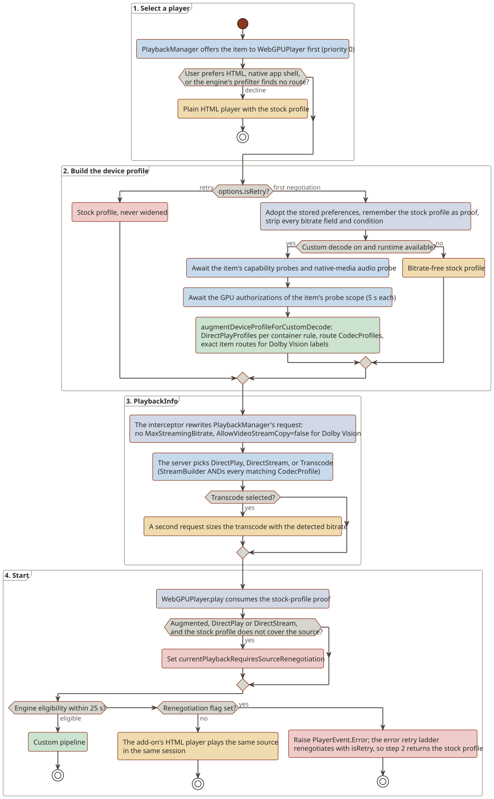
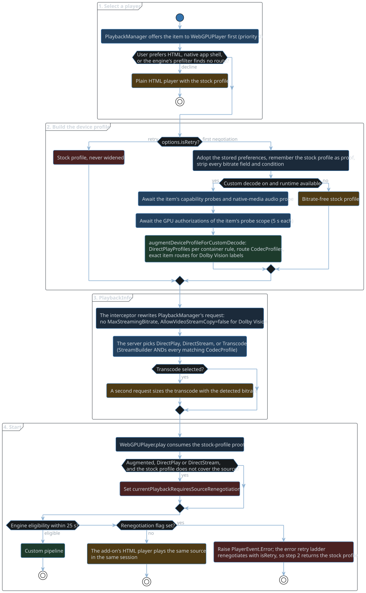

# Negotiation

This chapter follows a playback from player selection to a Jellyfin decision.
Player selection, the device profile, and the PlaybackInfo requests are add-on code.
Eligibility, the probes, and the route catalog are engine code, in the engine's [Eligibility and routes](https://alchemyyy.github.io/WebGPU-Player/routes.html) chapter.
The stock profile is the one the add-on's HTML backend returns from `getDeviceProfile`.

## Flow

1. Select a player.
   PlaybackManager offers the item to players in priority order, and `WebGPUPlayer` (priority 0) comes first.
   `HostCompatibleWebGPUPlayer.canPlayItem` declines when the user prefers the HTML player or inside a native app shell.
   With custom decode enabled, `WebGPUPlayer.canPlayItem` also requires the engine's metadata-only prefilter, `hasPotentialCustomPlaybackVideoRoute`.
   When it declines, PlaybackManager picks the plain HTML player, which negotiates with the stock profile.
2. Build the device profile, in `WebGPUPlayer.getDeviceProfile(item, options)`:
   - A retry (`options.isRetry === true`) returns the stock profile unchanged.
   - Otherwise it adopts the stored playback preferences, keeps the stock profile as a per-item proof (`rememberNativeDeviceProfile`), and strips every bitrate field and condition (`createBitrateIndependentDeviceProfile`).
   - It stops there when custom decode is off or the engine's `getCustomPlaybackRuntimeAvailability` fails (secure context, Worker, `navigator.gpu`, `VideoFrame`).
   - It awaits the engine's `probeCustomDecodeCapabilities(item)` and the native-media audio probe.
     PlaybackInfo waits until the probes the item selects settle; a probe an earlier item ran is not repeated.
   - In parallel, `getDeviceProfileDecoderPackages` lists what the user's decoder packages and the server's catalog decode, with each video package's header, the video ones only when the presenter's device holds a frame pool, each with that device's buffer limit (see [Decoders and passes from the server](server-modules.md)).
   - `getHDRDeviceProfileOptions` waits for the GPU authorizations the item's HDR scope needs (5 s each; see [Probe scopes](#probe-scopes)) and returns the flags and route keys.
   - `CustomDeviceProfile.augmentDeviceProfileForCustomDecode` builds the profile, and `HostCompatibleWebGPUPlayer` marks it so the PlaybackInfo interceptor recognizes the request.
3. Request PlaybackInfo.
   The add-on's axios interceptor (`compat/PlaybackInfoInterceptor.ts`) applies the player's request rules (`compat/PlaybackInfoPolicy.ts`) to the body that stock PlaybackManager built:
   - The selection request carries no `MaxStreamingBitrate`.
   - `AllowVideoStreamCopy` becomes false when `WebGPUPlayer.supportsVideoStreamCopy` vetoes the source, which it does for any Dolby Vision descriptor and any interlaced video (see [Interlaced video](#interlaced-video)).
   - When the selected source will transcode, a second request sizes the transcode with the detected bitrate.
4. Start the session.
   `WebGPUPlayer.play` consumes the stock-profile proof.
   It sets `currentPlaybackRequiresSourceRenegotiation` when the profile was augmented, the method is DirectPlay or DirectStream, and `NativeDirectPlayCompatibility.isSameSessionNativePlaybackCompatible` fails for the stock profile.
5. Check eligibility.
   `startCustomPlaybackBounded` (25 s) calls the engine's `getCustomPlaybackEligibility` with the route flags and authorized keys the profile adopted.
   Every HDR and Dolby Vision flag also requires the user's HDR tone mapping setting, and `allowRawSDR` needs only a settled `:sdr` raw key.
   A direct play without a native video route downloads the server's video packages its video needs, and an eligibility that refused the audio track downloads the server's audio packages of the track's codec, then runs again.
6. Fall back.
   An ineligible, timed-out, or failed start falls back.
   Without the renegotiation flag, the add-on's HTML player plays the same source in the same session.
   With it, the player asks for a renegotiation.
   On stock Jellyfin Web that is the error retry ladder, whose `changeStream` passes `isRetry`, so the retry negotiates with the stock profile and is never widened.
   An ineligible start logs its eligibility reason with `console.warn` first, since it raises no error of its own.

## How the profile is augmented

`augmentDeviceProfileForCustomDecode`, in order:

1. Strip bitrate.
2. Find the supported video and audio codecs, a decoder package's among them.
3. Add one DirectPlayProfile per rule in the engine's `CUSTOM_CONTAINER_CODEC_RULES`.
4. Add the custom subtitle profiles (vtt, ass/ssa, pgssub).
5. Scope the stock video and container conditions to non-custom containers.
6. `widenAuthorizedHDRCodecProfiles`.
7. `appendMeasuredVideoRouteProfiles`.
   Each route profile requires VideoRangeType, VideoBitDepth, and VideoProfile, and `IsInterlaced=false` where the route takes only progressive video (see [Interlaced video](#interlaced-video)).
   A codec with several routes is split with ApplyConditions.
8. `appendPackageVideoSizeProfiles`: the Width and Height bounds of the decoder package routes (see [Sizes](#sizes)).
9. `appendMeasuredAudioRouteProfiles`.
10. `splitOriginalAudioRouteProfiles`.

## What the profile advertises

The profile advertises ranges per item HDR scope.
A known-SDR item gets no HDR routes, and an item with missing metadata is scoped `unknown` and gets all of them.
The raw Dolby Vision route also advertises DOVIInvalid, Jellyfin's label for P8 outside CCIDs 1, 2, and 4 (and, on Jellyfin 12, for a base whose color contradicts its CCID), because RPU reconstruction presents any CCID.
The generic DOVIWithEL ranges are advertised with or without the bundled HEVC decoder's Main 10 qualification, because P7 reconstructs from its base layer when no qualified decoder decodes the EL.
The profile never advertises more than the engine's support matrix, in its [HEVC and Dolby Vision support](https://alchemyyy.github.io/WebGPU-Player/codec-support.html) chapter, can play.
[Direct play support](direct-play-support.md) maps each of its rows to the label Jellyfin gives it and whether the profile negotiates it.

Per codec, the routes are:

- AV1 (VideoProfile `main`):
  - native SDR at 8 bits;
  - raw HDR10, HDR10Plus, and HLG at 10 bits;
  - raw Dolby Vision Profile 10 at 10 bits (DOVI, DOVIWithHDR10, DOVIWithHDR10Plus, DOVIWithSDR, DOVIWithHLG, and DOVIInvalid, never DOVIWithEL), when `rawHDRVideo.av1` passes and the `I420P10:dovi-rpu-v1` key is authorized;
  - raw SDR at 10 bits.
- VP9:
  - native SDR at 8 bits (`profile 0`);
  - raw HDR10, HDR10Plus, and HLG, and raw SDR, at 10 bits (`profile 2`).
- HEVC: as [Direct play support](direct-play-support.md) lists, with raw SDR at 10 bits (`main 10`) beside the native Main 10 SDR route.

Every raw HDR route that advertises HDR10 also advertises HDR10Plus, because HDR10+ always carries a static HDR10 base that raw PQ presents (`getRawHDRRouteVideoRangeTypes`).

Raw SDR at 10 bits needs `allowRawSDR` with both I420P10 BT.709 SDR keys, limited and full, because a profile condition cannot express color range.

Jellyfin labels many Dolby Vision streams the engine can present outside the generic Dolby Vision ranges:

- P4 and P20 by transfer (SDR under a `dvhe` or `dvh1` sample entry);
- DV over Rext, Main 12, or 8-bit Main under a profile and depth the generic ranges do not pair with that label;
- a P10 Matroska stream without a CCID, by transfer.

For a non-retry Dolby Vision item, `getHDRDeviceProfileOptions` passes the item's streams as `itemMediaSource`.
`CustomDeviceProfile` asks the engine's `hasEligibleCustomVideoRoute` whether the runtime would present the item with the measured capabilities and authorizations, the video packages of `decoderPackages`, and `allowFramePoolHDR`.
A video package's summary carries its header and the device's buffer limit, so the engine runs the offers' fit check on the item's stream: its `accepts` conditions, `monochrome`, frame pool, `state`, `buffer:`s, and packet ring.
If it would, `CustomDeviceProfile` advertises the item's exact VideoProfile (as the existing route token), VideoBitDepth, and VideoRangeType as one more HEVC or AV1 route.
So without native HEVC decode, a stream whose declared base the HEVC decoder package decodes, such as Profile 7 or 8.1, is advertised, and one past the package's bound of 8912896 coded samples, such as 8K, is not.

## Decoder packages

The profile advertises what the decoder packages a playback can use decode, before any of them is downloaded: the user's own packages and the server's.

- A video package's route is per profile, with the depths whose formats it writes, SDR, and HDR10, HDR10Plus, and HLG when the user's HDR tone mapping is on (`allowFramePoolHDR`).
  It takes interlaced video unless its codec codes the fields apart, as every measured route does.
- AV1 takes `main` for 4:2:0 at 8 and 10 bits, `high` for 4:4:4 at 8 and 10 bits, and `professional` for 4:2:2 and 12 bits.
  VP9 takes `profile 0` to `profile 3` by depth and chroma the same way.
  A profile and depth is advertised only when the packages write every chroma format its streams may carry, so AV1 `professional` at 12 bits needs 4:2:0, 4:2:2, and 4:4:4.
- HEVC takes `main` and `main 10` for 4:2:0, each named range extension profile for its format, and generic `Rext` at a depth whose every chroma format the packages write.
  Generic `Rext` is also the label of 4:0:0 streams, so it needs a package that declares `monochrome`.
- A codec only packages decode, such as MPEG-2, VC-1, or JPEG 2000, takes one route without a profile condition, at the depths of the formats its packages write.
- A package codec with stock CodecProfiles, AV1 or HEVC, widens their custom-container ceiling with its profiles and depths, as a raw route does (`createRawCodecProfilePlans`, `createAuthorizedHEVCProfilePlan`).
- An audio package's codec is a decoded route at every channel count its decoded PCM path presents; DTS and TrueHD keep their exact profile routes.
  Native-media AC-3 and E-AC-3, which take 48 kHz only, step aside for a package that decodes them.

### Sizes

A video package's route covers only the picture sizes some package takes on the device: its `accepts` conditions, and its frame pool, `state`, `buffer:`s, and packet ring within the device's buffer limit, the smaller of its largest buffer and largest storage binding.
`PackageRouteSizes.ts` finds them with the engine's `isGPUVideoDecoderSummaryFit`, the offers' own check, for each profile and depth, at the tightest of the formats its streams may carry.

- The bound is a staircase, since `accepts` may bound the area as well as each side: the height a width takes falls as the width grows.
  It steps at the widths 1280, 1920, 2560, 3840, 4096, and 7680, and at the widest the packages take, and each step bounds the widths since the previous one by the height its own width takes.
- `appendPackageVideoSizeProfiles` adds one CodecProfile per step, for the ranges no native or raw route takes at that profile and depth, and the profiles of one depth whose steps match share them.
  Its ApplyConditions name the range, the profiles, the depth, and past the first step the width since the previous step; its Conditions bound the height, and the first step's the width too.
  Each requires the range among its Conditions as well, which marks it as the add-on's.
- On a device at WebGPU's default 128 MiB storage binding, HEVC Main 10 stops below 1080p at 1920 wide, since the HEVC package's pool of 29 I420P10 slots is about 186 MB at 1080p; 720p fits.
  On a 2 GiB device it takes every size its header accepts, 3840x2160 and 4096x2160 among them, and 8K none.
- Jellyfin labels a 4:0:0 AV1 stream `main` and a 4:0:0 JPEG 2000 stream with no chroma at all, and the pixel format is no profile condition, so such a stream still negotiates for a package without `monochrome`, then fails eligibility and renegotiates.
- A package without a header, such as an older catalog's, takes every size.

## Interlaced video

The engine deinterlaces every route but Dolby Vision's, for each codec whose decoders keep both fields in one frame: H.264, MPEG-1, MPEG-2, VC-1, WMV3, VP8, VP9, and AV1 (`presentsInterlacedVideo`, in the engine's [Interlaced video](https://alchemyyy.github.io/WebGPU-Player/routes.html#interlaced-video)).

- A route requires `IsInterlaced=false` only when its codec codes the fields apart, HEVC and JPEG 2000, or it presents a Dolby Vision label (`requiresProgressiveScan`).
- A stock profile's `IsInterlaced` condition, which Jellyfin Web adds for H.264 and HEVC because a browser shows interlaced video woven, is removed in custom containers for a codec the engine deinterlaces, as the runtime ceilings are.
- Jellyfin applies the same codec profiles to the containers of an HLS transcode, `ts` and `mp4`, as to direct play, so without the scan limit it would copy interlaced H.264 into HLS for the HTML player.
  `supportsVideoStreamCopy` vetoes the copy of any interlaced source instead, so a transcode re-encodes and deinterlaces it, as it does with the stock profile.
- The deinterlacing choice in the WebGPU settings (see [The client add-on](add-on.md#settings)) changes only how the presenter shows interlaced frames, so the profile stays the same for every mode, off included.
  Jellyfin's MediaStream reports `IsInterlaced` but no field order, so each frame's field order comes from its decoder, parser, or container, else top field first.

## Audio

- The profile advertises the engine's audio routes per codec and channel count, as the engine's [audio routes](https://alchemyyy.github.io/WebGPU-Player/routes.html#audio-routes) list them.
- The profile uses `AudioSampleRate NotEquals 0`, because Jellyfin reuses conditions as transcode targets.
- AC-3, E-AC-3, and PCM have no runtime probe, so `appendMeasuredNativeAudioRouteProfiles` never emits its 48 kHz profile.
- A profile condition cannot express ChannelLayout, so three-channel routes and E-AC-3 and TrueHD 7.1 are advertised by channel count and qualified by layout only at eligibility.

## Probe scopes

`getHDRDeviceProfileProbeScope` picks the GPU authorizations an item waits for:

| Scope | Waits for |
| --- | --- |
| `none` | Nothing: a known-SDR item |
| `static-hdr` | Native external HDR, and raw HDR only when no external key is authorized |
| `dolby-vision` | Dolby Vision only; the item declares no HDR base |
| `dolby-vision-profile7`, `dolby-vision-profile8-hdr10-base`, `dolby-vision-profile8-hlg-base` | Dolby Vision and native external HDR, for the exact native base |
| `dolby-vision-hdr-base` | Dolby Vision, in parallel with the `static-hdr` waits, for a declared PQ or HLG base outside those exact shapes |
| `unknown` | Native external HDR, raw HDR, and Dolby Vision |

The scopes assume HEVC, whose static HDR prefers the native external route.
An AV1, VP9, or HEVC range-extension item presents HDR only through raw planes, so in every scope that can present an HDR base it also waits for raw HDR, in parallel and whatever the external result.
Eligibility waits the same way for such an item whose metadata or declared Dolby Vision base is PQ or HLG.

The Dolby Vision wait also settles the item's first-use key: Profile 4 in any format, or Profile 7 or single-layer reconstruction in a format other than I420P10.
Every non-retry profile also waits for the raw SDR authorization, whatever the scope.

## Gotchas

- Jellyfin ANDs the conditions of every matching CodecProfile (`StreamBuilder`).
  A looser added profile cannot override a stricter one, so stock profiles are split by container, and codecs with several routes use ApplyConditions.
- The server matches a profile container against any token of the probed container.
  Every MP4/MOV file probes as `mov,mp4,m4a,3gp,3g2,mj2`, so a stock split never names an alias of a codec's route containers (`getCustomContainerFamilyForVideoCodec`).
  A stock HEVC split scoped to `mj2,webm`, for example, rejects every Dolby Vision range in MP4 files.
- Width, Height, VideoLevel, and VideoFramerate are removed only for custom containers, as is IsInterlaced for a codec the engine deinterlaces.
  Bitrate is stripped everywhere on non-retry profiles.
- HEVC routes expand to every (VideoProfile, VideoRangeType) pair, with `VideoBitDepth Equals 0` as the value that always fails.
  AV1 and VP9 expand the same way when they have more than one route, so their native 8-bit SDR and raw 10-bit SDR share one SDR pair with both depths.
  H.264 is not expanded.
- Generic `Rext` advertises a bit depth only when 4:2:0, 4:2:2, and 4:4:4 at that depth are all authorized (`hasCompleteRextBitDepthEnvelope`).
- The native external route needs explicit color fields that a profile cannot express.
  Such a source can negotiate DirectPlay and then take the raw route or fall back.
- A profile condition cannot express color primaries, so 10-bit SDR AV1 or VP9 tagged BT.601 or BT.2020 negotiates and then fails eligibility: the raw SDR keys are BT.709 only.
- A P10 Matroska stream without a CCID, labeled by transfer, negotiates through the static HDR ranges, but it declares no base, so it plays only through its RPU route.
- `customProfileAugmentationAvailable` stays set for the lifetime of the player instance.
- Dolby Vision and interlaced sources always disable HLS video stream copy, so an HLS fallback re-encodes the video.
