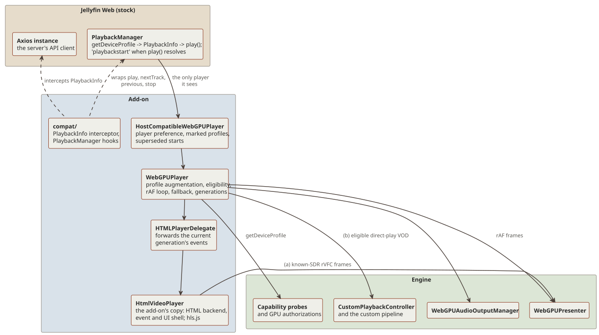
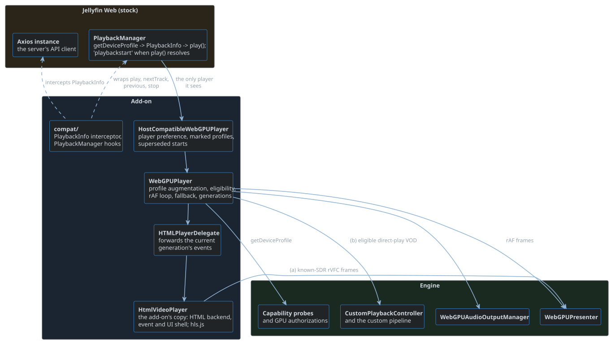

# Playback in Jellyfin Web

This chapter follows the host's half of a playback session.
The engine's [Architecture](https://alchemyyy.github.io/WebGPU-Player/architecture.html) chapter follows the custom pipeline below it.

## Layers

`WebGPUPlayer`, `HTMLPlayerDelegate`, and `HtmlVideoPlayer` with its hls.js runtime are add-on code, and `WebGPUPlayer` runs the engine's frame loop, `CustomPlaybackFrameLoop`.
The engine's [Architecture](https://alchemyyy.github.io/WebGPU-Player/architecture.html#layers) chapter details its side of the diagram.

## Startup of a custom session

1. `WebGPUPlayer.play` advances the presentation generation and consumes the stock-profile proof.
   Before it, `HostCompatibleWebGPUPlayer.play` claims the stream head the negotiation read ahead when the stream is the predicted direct play, and cancels it otherwise (see [Negotiation](negotiation.md#the-streams-head-read-ahead)).
   It runs `prewarmBrowserAudioContext(48000)` (engine) synchronously inside `play()` (the user-activation window), calls `presenter.startSession`, and queues `startBackendPlayback`.
2. `startCustomPlaybackBounded` runs the engine's eligibility check, described in [Negotiation](negotiation.md#flow).
   It waits for the raw SDR prewarm, and for the stream's own raw SDR key when that key authorizes on first use, as every key outside BT.709 does.
   An HDR range-extension source also waits for the raw HDR prewarm, and a Dolby Vision source waits for its first-use key (Profile 4, or Profile 7 or single-layer reconstruction outside I420P10).
   Other HDR and Dolby Vision routes use only keys that have already settled.
   Its 25 s bound lasts until the controller starts, and the controller's own startup bound applies after that.
3. The add-on loads the engine pipeline as the `webgpu-custom-playback` chunk, which a head read ahead has usually loaded already.
   `HtmlVideoPlayer.prepareCustomPlayback` returns a source-less `<video>`.
   The presenter enters push mode, and the engine's `configurePresentationColorPipeline` installs the shaders for the selected route.
4. The engine's controller starts the session; see its [Architecture](https://alchemyyy.github.io/WebGPU-Player/architecture.html#startup-of-a-custom-session) chapter.
   Its first run continues on the head read the negotiation started, in the decode worker that read started in.
5. When the controller emits `ready` and `playing`, the frame loop starts, `play()` resolves, and PlaybackManager emits `playbackstart`.

## Steady state

- The frame loop takes the controller's current frame each animation frame and presents it.
- No animation frame runs while the page is hidden, so the frame loop's 25 ms timer takes and discards due frames against the clock instead.
  Credits keep flowing and audio stays the master.
  An open picture-in-picture window is the exception while the hidden page still paints for it; see [Picture-in-picture](#picture-in-picture).
- A screen wake lock is held while the controller is playing, because the source-less `<video>` never earns the browser's own video wake lock.
  It is kept across seeks, released on pause, end, stop, and fallback, and requested again when the page becomes visible.
- Before eligibility, `WebGPUPlayer` resolves the user's speaker layout against the destination's channel count with the engine's `selectCustomAudioSpeakerLayout`, stereo when the user forces stereo, and hands it with the binaural choice to the engine's eligibility as `audioRenderTarget`.
  At startup the count is the audio prewarm's `destination.maxChannelCount`; at a track switch it is the live output's, else the prewarm's; without either the layout is stereo.
- Each decoded PCM track then plays to the engine's `selectCustomAudioOutputLayout` of that layout, the whole layout when the eligibility reports `audioRendersObjects`, and the binaural choice goes with it to `play`, `setAudioStreamIndex`, and `reconfigureAudioOutput`.
- `play` and `setAudioStreamIndex` also take the track's `audioMetadataLayout` (`getAudioMetadataLayout`): Jellyfin's channel count, which screens a track whose container declares a count no layout has, as a Matroska header written from its first frames can, and the speaker mask of a 2.1 FLAC, whose decoder reports none.
- Each playback keeps a snapshot of the audio settings it started with; the settings panel updates it as it applies a change.
- The add-on triggers a live audio output switch when the output reports `sinkchange` with a different channel count, and when force stereo, the speaker layout, binaural rendering, or the downmix algorithm changes.
  A binaural change that keeps the layout applies between packets without a pause.
- The stats overlay's audio category shows the output layout and the number of objects a decoder package renders, each once the engine reports it.
- Re-detect output, in the WebGPU settings, rebuilds every AudioContext sink so the browser re-reads the device.
  Chromium moves a default output to a new device without telling the page, which leaves a stale channel count until a rebuild.
- The deinterlacing choice in the WebGPU settings reaches the presenter live through `WebGPUPlayer.setDeinterlaceMode`.
  Double rate and single rate share one plan, so a switch between them shows at the next draw; a switch to or from off builds a new plan, and the frame loop's lookahead follows it (see the engine's [Architecture](https://alchemyyy.github.io/WebGPU-Player/architecture.html)).
- The black bar crop choice in the WebGPU settings reaches the presenter live through `WebGPUPlayer.setBlackBarCropEnabled`.
  While it is on, the presenter finds the black bars encoded into the video from the frames as they play and presents only the picture, which fits the video box by its own shape, so a letterboxed film fills an ultrawide screen and the Cover aspect mode zooms the picture, not the bars; on a screen of the frame's own shape a letterboxed film looks the same.
  A picture a few lines from a standard film or television aspect ratio, such as 2.39:1 or 1.85:1, from the table the Detect Aspect Ratio plugin snaps to, presents at exactly that ratio, as long as that shows no more than half a line of each bar.
  The crop holds through dark scenes and fades; a picture that grows into the bars, such as a film's IMAX scenes, shows whole at once, and the bars crop again only after the picture keeps to them across shots for about half a minute.
  Subtitle layers keep their placement over the video box.
- `WebGPUPlayer.isFetching` mirrors actual backend file-loading state, not custom decoder startup or seeking.
  This keeps "Fetching additional data" paired with `beginFetch`/`endFetch`; normal playback waiting does not leave a phantom subtitle-loading message.

## The `<video>` element

The source-less `<video>` stays the HTML player's own, but other scripts on the page follow the player through it, such as Jellyfin Enhanced's pause screen, tab-switch pause and resume, playback rating badge, intro skip, and bookmarks.
So `WebGPUPlayer` has `CustomPlaybackMediaElement` report the custom playback through the element, from when the controller is created until it is cleared by a stop, a new play, or a fallback, which hands the element back to the HTML backend.

- `paused`, `ended`, `seeking`, `readyState`, `currentTime`, `duration`, `playbackRate`, and `currentSrc` read the playback; `currentSrc` is the stream URL Jellyfin chose.
  The members are shadowed on the element itself, and a member another script replaced meanwhile stays as that script left it.
- `play()`, `pause()`, and a `currentTime` write resume, pause, and seek the controller, as the OSD does, so Jellyfin Web's events and the OSD follow.
  A seek is clamped to the duration, and a non-finite time throws a `TypeError`.
  `playbackRate` takes only the playback's own rate and throws `NotSupportedError` for another, as a browser does for a rate it does not support, since the player offers no other rate for custom playback.
- The element fires the events of a playing element, from the controller's events: `loadstart` and `play` at the start, `durationchange`, `loadedmetadata`, `loadeddata`, `canplay`, and `canplaythrough` at the first ready, then `playing`, `waiting`, `timeupdate`, `pause`, `play`, `seeking`, and `seeked`, and `pause` and `ended` at the end.
  A seek completes when the controller leaves the seeking state it entered for it, or when the seek, or an audio track restart that superseded it, starts the playback at its position.
  When the report ends, a playing element fires `pause`, then `emptied`.
  The events fire as microtasks, in order, so no listener runs inside the controller call that caused it.
- The HTML player's own media handlers, and the start position a native source left waiting on the element, skip these events (`isCustomPlaybackMediaEvent`), since the controller notifies that player directly; handling them as well would end a playback twice.
- Meanwhile the element carries `disablepictureinpicture`, so a script that asks the element itself for picture-in-picture, such as one that enters it on a tab switch, skips it, since it has no frames to show.
  The player's own picture-in-picture shows custom playback through a `<video>` of its own; see [Picture-in-picture](#picture-in-picture).

## Picture-in-picture

The OSD's picture-in-picture button shows whenever `supports('PictureInPicture')` holds, and opens and closes the window through `togglePictureInPicture`.

- An HTML playback shows in its element's own window, as in stock Jellyfin Web, even while WebGPU presents it on the page.
  The browser keeps decoding a video in picture-in-picture while the page is hidden, but Chromium stops decoding the video track of a hidden page's other videos, so a copy of WebGPU's picture of it would stop there.
- Custom playback shows in the window of `CustomPlaybackPictureInPicture`, whose `<video>`, outside the document, plays the stream captured from a 2D canvas.
  Each picture the presenter draws reaches that canvas through the engine's `WebGPUPresenter.setPresentedPictureObserver`, in the task that drew it, the only time a WebGPU canvas can be read, cropped to the picture's region of the canvas and scaled to at most 1920 on its longer side.
  `supports('PictureInPicture')` holds for it while custom playback starts or plays, in a browser with the Picture-in-Picture API and canvas capture.
- The window's video plays while the playback plays and pauses while it pauses, which the window's controls show.
  Jellyfin Web's media session handlers take the window's play and pause buttons, and a pause or play of the video's own, as closing the window pauses it, reaches the controller.
- A paused stream keeps the frame it rendered last, so the video plays until it renders a picture copied while paused, as a seek while paused draws one.
  A window that opens on a paused playback asks the playback to draw its frame again, as a resize does, since the presenter keeps no picture to copy.
- Chromium keeps painting a hidden page while one of its videos is in picture-in-picture, so animation frames keep running there.
  Once one has run since the page was hidden, the frame loop presents as on a visible page while the window is open, and the controller keeps its video decoder.
  A browser that stops painting the page leaves the window on the last picture and the playback on the hidden page's drain.
- The window stays open across a stop between queued items, paused on the last picture, for the next playback; a player torn down closes it.
  Once the HTML backend plays the source itself, after a fallback or for a next item it plays, the window moves to the backend's element.
  A native playback's window moves to a custom playback that follows it in the element, before the element carries `disablepictureinpicture`, which would close it.
  While a window is open, either request needs no user gesture.

## Transitions

- Seek: a new presentation generation, then `controller.seek`.
  `customPlaybackSeekRevision` is checked before a queued seek reaches the controller and again when it settles, so a burst of seeks collapses to the newest, a stale result or failure is dropped, and a seek queued before a stop never runs.
  A running seek is replaced by the next one, since the controller supersedes its generation.
  A seek while setup has no controller yet becomes the startup position: the custom start's, or the HTML backend's if setup declines.
  A seek that supersedes the decoder's startup does not cancel the play request; `play()` settles with the newest seek's startup, and a failure of that seek joins the fallback it already began.
  Setup counts as starting for its whole bounded attempt, including an ineligible source, so seeks reach the HTML backend once setup declines.
- Audio track switch: eligibility runs again.
  If the source is no longer eligible, the session renegotiates; otherwise it restarts as a seek at the current time.
  An external audio file's stream is never eligible (`audio-track-external`), since only the server muxes it in, so switching to one renegotiates rather than playing an embedded track.
- Speed change: Jellyfin Web's speed menu shows whenever `supports('PlaybackRate')` holds, which is always on the custom path (starting, playing, or falling back) and on an HTML path only when its backend supports it.
  The custom path offers 0.1x, 0.25x, 0.5x, 0.75x, 1x, 1.25x, 1.5x, 1.75x, 2x, 2.5x, 3x, 4x, 6x, 8x, 10x, and 16x, but the list is only a menu: `setPlaybackRate` takes any rate, so SyncPlay's speed-to-sync rates work.
  A current rate missing from either path's list, such as SyncPlay's 1.06x or 8x after a fallback to the HTML player, whose list ends at 4x, joins the list in order as `<rate>x`, since the menu's check mark and the speed keys find the current entry by an exact id match, and a miss sends both keys to the first entry.
  `setPlaybackRate` coerces a string with `Number`, ignores a rate that is not finite or not above 0, and clamps the rest to 0.0625x through 16x.
  `play()` resets the requested rate to 1, as a media element's load does, and the OSD re-applies its stored rate on `playbackstart`.
  A rate requested while setup has no controller yet is stored and handed to the controller before it plays.
  A change that crosses the engine's audible range, 0.25x through 4x, with an audio track restarts the generation at the current time, as an audio track switch does; a startup it supersedes settles with that restart, and its failure falls back.
  Every other change applies live.
  The same-session HTML fallback re-applies a rate other than 1 once its `play` resolves, since its load resets the element to 1.
  The engine's [Architecture](https://alchemyyy.github.io/WebGPU-Player/architecture.html) chapter covers its clock, and its audio and video, at other rates.
- Stop: the delegate stops the backend synchronously, so `stopped` stays in order.

## Fallback and renegotiation

The engine's `getFallbackDisposition` decides whether a failure falls back to the HTML player in the same session or renegotiates the source.

- When `currentPlaybackRequiresSourceRenegotiation` is set, every reason renegotiates, because the stock profile does not cover the source.
- Failures in the wrapper itself (presenter, frame submission, rAF) are `lifecycle-failed`.
- Renegotiation fires `sourcerenegotiationrequired` once per session.
  A listener accepts it only by calling `accept()` synchronously during dispatch.
  Stock Jellyfin Web has no listener, so the player raises `PlayerEvent.Error` instead and PlaybackManager's error retry ladder asks for a transcode.
  During a start, `play()` resolves first and the error follows.
- Fallback never selects another player.

Every stale callback is dropped by a generation or revision check.
On the add-on's side:

- `WebGPUPlayer`: the presentation, backend session, setup, seek, audio selection, frame, and terminal error revisions.
- `HTMLPlayerDelegate`: the forwarding generation.

## Gotchas

- The add-on's `HtmlVideoPlayer.play()` runs synchronously only when custom decode is off and no teardown is pending.
  Otherwise it runs after the asynchronous eligibility check.
